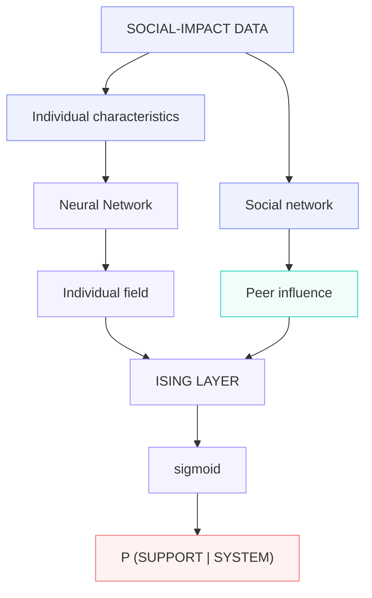

# Introduction

Social-impact assessments rely on quantitative socioeconomic and environmental variables that are integrated into baseline indicators. Additionally, assessments often include qualitative information gathered through interviews, focus groups and participant observation. Both, quantitative and qualitative information serve to monitor and evaluate how communities may respond to infrastructure, extractive, energy, or development projects. 

Yet these approaches often treat stakeholder preferences as largely independent observations, despite the fact 
that social acceptance and rejection are inherently relational phenomena shaped by trust, leadership, group affiliation, 
information flows, and interactions among community members. 

This paper explores whether predictive models can better represent these dynamics by combining deep-learning techniques 
with an Ising-model of social interaction. 

The proposed framework uses individual-level characteristics and perceptions to estimate each stakeholder’s underlying 
propensity toward project support or rejection, while a network component captures the extent to which those attitudes may be reinforced, moderated, or reversed through interactions with others. 

By distinguishing individual predisposition from endogenous social alignment, the study aims to investigate whether collective support or opposition can be understood not simply as the aggregation of individual preferences, but as an emergent outcome of interactions within a social system. The broader objective is to assess whether such a hybrid framework can improve both the prediction and interpretation of social acceptance, while also providing a basis for analysing polarization, social amplification, and possible shifts in community attitudes under different project and engagement scenarios.

Conventional predictive methods such as logistic regression, decision trees, random forests, and artificial neural networks are well suited to identifying associations between observable characteristics and individual attitudes, but they generally assume that each observation can be modelled independently once the relevant covariates are taken into account. This assumption is restrictive in social-impact settings, where attitudes toward a project may evolve through interaction with family members, neighbours, community leaders, organisations, and other influential actors. 

A stakeholder who is initially favourable to a project may become more sceptical when embedded in a strongly oppositional network, while an initially uncertain individual may shift toward support if trusted peers perceive the project positively. Standard machine-learning models can incorporate proxies for these effects as additional features, but they do not naturally represent the reciprocal and potentially nonlinear dependence among actors. 

An Ising-inspired framework offers a way to introduce this interdependence explicitly by modelling each stakeholder as a node whose state reflects support or rejection and whose probability of changing state depends both on an individual field and on the weighted states of connected actors. Integrating this structure with machine learning therefore provides a means of separating individual-level determinants from endogenous social influence and of examining how their interaction may generate collective patterns that would be difficult to capture using predictive models alone.

## The Model 

The central research hypothesis is that representing relationships between stakeholders can improve predictions of changes in community attitudes relative to models that treat people independently. A simulation can test the implementation and explore this hypothesis. Evidence of improved prediction in real communities requires observed relationships and subsequent outcomes.

This model combines Artificial Neural Networks as predictors of individual propensity toward support or rejection
with an Ising component as the social interaction layer. It should be noted that Pratik Mullick and Parongama Sen [1] suggest that the scope of Ising-based sociophysics can be expanded and improve their predictive realism by integrating binary-agent models with modern machine learning techniques and large-scale social datasets. 

The core architecture is: 

Note: Each node in the peer influence represents a stakeholder or synthetic agent. 
It does not represent an attitude variable such as trust. An Ising network whose nodes are 
attitude variables would answer associations between them and not between peers [2].

The Artificial Neural Network would estimate something like this: 

$$
P(Y_i = 1 \mid X_i)
$$

where Xi = (demographics, economics, distance, trust, compensation, text embeddings, etc.)

In this case, stakeholders are conditionally independent. However, in the real world, the stakeholder's probability of supporting or rejecting a project may depend not only on her own perception but also on whether neighbours, family, leaders, or social network support it. 

A network of dependent logistic regression could be an approach as in [3]; however, we opt for the Ising layer.

The stakeholders are represented as Ising spins:

$$
s_i =
\begin{cases}
+1 & \text{supports project} \\
-1 & \text{rejects project}
\end{cases}
$$

And we have a network of stakeholders Sij representing the relationship between stakeholder i and stakeholder j:

$$
S_{ij}
$$

Then the Hamiltonian for the system has the form: 

$$
H =
-\sum_i h_i s_i
-\sum_{i,j} J_{ij} s_i s_j
$$

The first part represents the individual propensity. How inclined is stakeholder i to support /reject the project based on a set of variables that influence her stance. 

The second part is the social interaction, that is, how much stakeholder $\(j\)$'s position affects stakeholder $\(i\)$'s position. The constant $\(J_{ij}\)$ represents the interaction strength between the ith and jth stakeholder. If $\(J_{ij}>0\)$ the stakeholders tend to align whereas if $\(J_{ij}<0\)$ the stakeholders tend to diverge. 

The deep learning layer would be: 

$$
h_i = \{ANN}(x_i)
$$

While the social component would be: 
$$
-\sum_{i,j} J_{ij} s_i s_j
$$  

The probability of support would be:

## References

[1] Mullick, Pratik, and Parongama Sen. “Sociophysics Models Inspired by the Ising Model.” 
arXiv:2506.23837, arXiv, 30 June 2025. arXiv.org, https://doi.org/10.48550/arXiv.2506.23837.

[2] Finnemann, Adam, et al. “The Theoretical and Statistical Ising Model: A Practical Guide in R.” 
Psych, vol. 3, no. 4, Oct. 2021, pp. 593–617. DOI.org (Crossref), https://doi.org/10.3390/psych3040039.

[3] Mukherjee, Somabha, et al. High Dimensional Logistic Regression Under Network Dependence.

Osogami, Takayuki. “Boltzmann Machines and Energy-Based Models.” arXiv:1708.06008, arXiv, 18 Jan. 2019. arXiv.org, https://doi.org/10.48550/arXiv.1708.06008.

Castellano, Claudio, et al. “Statistical Physics of Social Dynamics.” Reviews of Modern Physics, vol. 81, no. 2, May 2009, pp. 591–646. DOI.org (Crossref), https://doi.org/10.1103/RevModPhys.81.591.

